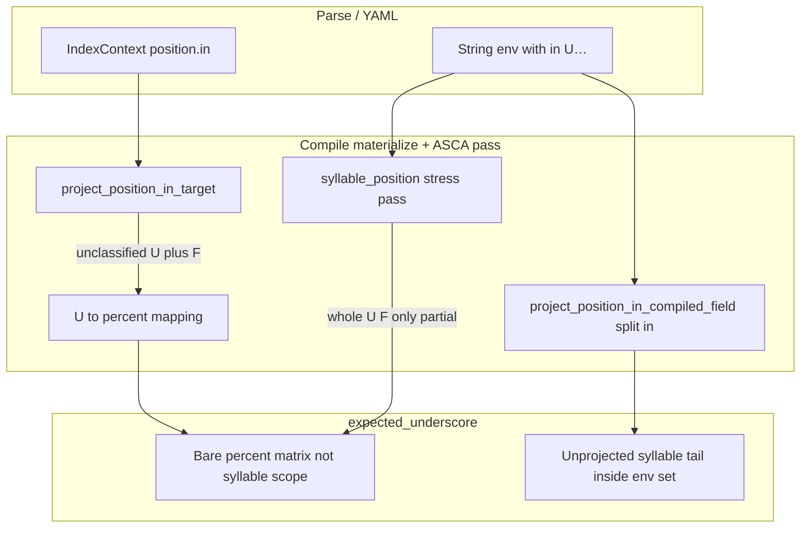

# `expected_underscore` inventory triage (syllable-position compile gaps)

Task: [0045-task-expected-underscore-syllable-compile-review](../items/0045-task-expected-underscore-syllable-compile-review.md). Full per-rule triplets: [`diagnostics/inventory/analysis/0045-expected-underscore-triplets.csv`](../../diagnostics/inventory/analysis/0045-expected-underscore-triplets.csv).

## TLDR

| Metric | Value |
|--------|------:|
| Inventory rows (`failure_class` = `expected_underscore`) | **102** |
| **Syllable-position compile gap** | **13** |
| **Compound env / env-set + position gap** | **27** |
| **Unrelated (prose, syntax, other)** | **62** |

Roughly **40 of 102** failures have a syllable-position or `position.in` compile seam as the **primary** cause; **62** should not be chased as syllable compile work. Within the syllable-related bucket, most fixes are **compile-time** (extend `position.in` projection and/or syllable-position post-pass on compiled env), not parse.

### Recommended follow-up tasks (titles only)

1. **Classify `position.in` `U[+hi]` / `U[+lo]` / `#U:[+stress]` → `<(..)_(..)>:[±F]` (no leading free `_`)**
2. **Compile `#U:[+stress]` and multi-feature `U[+long -stress]` position.in targets**
3. **Rewrite syllable fragments inside `:{…}:` env sets (incl. `… in U[+open]` splits)**
4. **Map whole-field syllable matrices (`U[-nas]`, lone `%[±F]` env) to `<(..)_(..)>:[±F]` (underline `_` inside the template only — no leading free `_`)**

Hold prose, `else`, Index `//`, and editorial env sets for separate env/prose clusters (not syllable compile).

Operator compile table for underline-scope syllable envs: [sound-change-applier.md](../../docs/system/sound-change-applier.md) (task **0049**).

---

## 1. Method

For each of the 102 rows in `diagnostics/inventory/rule-inventory-error.csv`:

1. **HTML** — line at `source` (`data/diachronica/index_diachronica.html`).
2. **Parsed YAML** — `env` / `exception` on the matching `rule_id` in `data/diachronica/index_diachronica.yml` (structured `IndexContext` when present).
3. **Compiled** — matching line from `diagnostics/compile/asca_rules.yml` (`rule`, `steps`, or `alternatives` by `alt_idx` / `step_idx`).

Classifications reference [sound-change-applier.md](../../docs/system/sound-change-applier.md), [0039-index-syllable-position-u-hash](0039-index-syllable-position-u-hash.md), `position_in_projection.py`, and `syllable_position.py`.

---

## 2. Syllable-related fix families

### F2 — Unclassified structured `position.in` (12 rules)

**Symptom:** YAML has `env.position.in` with syllable-open/closed or vowel-height features. Materialize falls through to `in {v}` → group mapping `U`→`%` → compiled env **`%[+hi]`** / **`%[+lo]`** (raw `%` matrix) instead of a syllable **underline scope**.

**Representative: `Egyptian-Arabic-aj-aw`**

| Layer | Content |
|-------|---------|
| HTML | `aj aw → eː oː / in U[+closed]` |
| Parsed | `env.position.in: U[+hi]` (Index hi/closed → `+hi` feature) |
| Compiled | `aj aw > e:[+long] o:[+long] / %[+hi]` |
| ASCA error | Expected `_`, received `` at env start (no underline structure) |

**Representative: `Luwian-V_2`**

| Layer | Content |
|-------|---------|
| HTML | `V → Vː / in U[+stress]` (stressed first syllable) |
| Parsed | `env.position.in: "#U:[+stress]"` |
| Compiled | `V > V:[+long] / #%:[+stress]` |
| ASCA error | Expected `_`, received `` |

**Fix:** Extend `project_position_in_target()` and materialization the same way as classified `U[±stress]`: emit **`<(..)_(..)>:[+hi]`**, **`<(..)_(..)>:[+lo]`**, **`<(..)_(..)>:[+long -stress]`** (and analogous bracket tails), **without** a leading free `_` or bare `%[±F]`. For word-initial stressed syllable (`#U:[+stress]`), use **`#<(..)_(..)>:[+stress]`** (underline `_` inside `#<…>` only), not `#%:[+stress]`. Reuse / generalize `_matrix_brackets_from_u_colon_target` and `_SYLLABLE_STRESS_ENV_RAW` patterns in `syllable_position.py`.

**Code seam:** `src/conlanger/compile/position_in_projection.py` (`project_position_in_target`, `materialize_position_in_asca`); share matrix-tail logic with `syllable_position.py` (`project_syllable_stress_compiled_env`).

**Rule IDs:** Egyptian-Arabic-aj-aw, Luwian-V_2, French-è, French-è_3, French-ò_2, French-é, French-é_2, French-ó (both steps), French-ó_3, French-a_3, Papabuco-Chatino-ẽ_3.

---

### F1 — Whole-env syllable matrix without focus (1 rule)

**Representative: `Miami-Illinois-s-ʃ`**

| Layer | Content |
|-------|---------|
| HTML | (nasal harmony env on syllable class) |
| Parsed | `env: U[-nas]` (string) |
| Compiled | `s ʃ > N s N ʃ / %[-nas]` |

**Fix:** When the **entire** env is a syllable-class feature matrix (`U[±F]` / `%[±F]` after mapping), project like whole-field `U[±stress]` / `%[±stress]`: **`<(..)_(..)>:[-nas]`** — segment focus lives in the **underline structure**, not as a separate leading `_` before the syllable template (same pattern as `_SYLLABLE_STRESS_ENV_RAW` in `syllable_position.py`). Extend `_compile_syllable_stress_env_from_raw` / `project_syllable_stress_compiled_env` for non-stress feature matrices (e.g. `[-nas]`).

**Code seam:** `syllable_position.py` → `project_syllable_stress_compiled_env` / `_compile_syllable_stress_env_from_raw`.

---

### F3 — Env sets containing syllable fragments (21 rules)

**Symptom:** String envs with `… in U[+open]` (or similar) are split into `:{left, right}:` via `project_position_in_compiled_field`, but the **right** side stays as `%[+lo]` / `%[+hi]` **inside the set** instead of `<(..)_(..)>:[±F]`. Prose tails inside the set (Hittite, Gothic) also break ASCA at `}:`.

**Representative: `Luwian-D-R`**

| Layer | Content |
|-------|---------|
| HTML | `D R → Dː Rː / ”e_ in U[+open]` |
| Parsed | `env: e:[+stress]_ in U[+lo]` (string) |
| Compiled | `… / :{e:[+stress]_, %[+lo]}:` |
| ASCA error | Expected `_`, received `}:` |

**Representative: `French-∅_6`**

| Layer | Content |
|-------|---------|
| Parsed | `{ʃ,ʒ,sj,zj}{a:[+stress],e:[+stress]}_ in U[+lo]` |
| Compiled | `∅ > j / :{{ʃ,ʒ,sj,zj}{a:[+stress],e:[+stress]}_, %[+lo]}:` |

**Fix:**

1. Before or after `split(" in ")`, detect syllable tails and project them (same as F2/F1).
2. For mixed prose + syllable inside one set (Hittite-e, Gothic-iji_2), defer prose to env/prose cluster; syllable fragment rewrite may still be required if prose is stripped later.

**Code seam:** `syllable_position.py` → `project_position_in_compiled_field` (lines that wrap `:{…}:`); must run **after** classified `position.in` materialize when env is structured+string hybrid.

**Rule IDs:** Hittite-e, Luwian-D-R, Gothic-iji_2, American-English-j, Polish-Cʲ, French-∅_6, Old-Provençal-—-a_2, Proto-Bantu_2 (3), Proto-Manenguba (6), Tataltepec-Chatino-l-n, Yaitepec-Chatino-lʲ, Chilliwack-Halkomelem-∅, Nooksack-∅ — see CSV.

---

### F4 — Classified `position.in` env plus Index exception prose (6 rules)

**Symptom:** Positive env from F2 (`%[+lo]`) coexists with exception prose or `//` blocks (`in #U with the following U…`). Validator often fails on `//` or empty focus on env first.

**Representative: `Kentish-Middle-English-ɑ-e-o`**

| Layer | Content |
|-------|---------|
| HTML | `ɑ e o → … / in U[+open] ! in #U with the following U…` |
| Parsed | `env.position.in: U[+lo]`; `exception` string with `#U` prose |
| Compiled | `… / %[+lo] // :{in #% with the following %…}:` |

**Fix (two-track):**

1. **Compile:** apply F2 to env (`<(..)_(..)>:[+lo]`, not bare `%[+lo]`).
2. **Exception / `//`:** out of scope for syllable compile — hold per [0039](0039-index-syllable-position-u-hash.md) (prose `#U` tails) and env/prose policy [0025](../items/0025-decision-env-and-prose-conditions.md).

**Rule IDs:** Kentish/Midlands/Northern/Southern Middle English `ɑ-e-o` (4), French-ò (both steps).

---

## 3. Unrelated failures (do not treat as syllable compile)

Post–0046–0048 disposition and current row counts: [0050 spike](0050-expected-underscore-u-families-disposition.md). Reclassifier: [`classify_expected_underscore_families.py`](../../diagnostics/inventory/analysis/classify_expected_underscore_families.py).

| Family | Count | Notes |
|--------|------:|-------|
| U1 bare `else` | 13 | Index `else` is prose, not ASCA env (`/ else`). |
| U2 Index prose env | 23 | Editorial conditions, commas, `when-stem final`, river names, etc. |
| U3 double-slash `//` | 6 | Index disjunction marker; ASCA expects `_` where `//` sits in env. |
| U4 env-set prose `}:` | 8 | `:{… if ə, an adjacent syllable}:` — prose inside sets (incl. Menominee “even syllables”). |
| U6 other empty-token | 11 | Valid-looking env without `_` but not syllable-position (e.g. bare `C[-nas]`, `iV`, `#_, possibly everywhere`). |
| U7 stray character | 1 | `Old-Mandarin-w_2` — complex env, failure on `ʲ`. |

**Contrast (working syllable compile):** Rules with mechanical `#U` / `U#` or classified `U[±stress]` / `#U, U#` that **do** project are documented in spike **0039**; they are absent from this failure class once compile passes.

Full rule lists per family: column `fix_family` in the triplets CSV.

---

## 4. Root-cause synthesis

1. **`position.in` classification gap** — Only stress, `#%` edges, and partial `U:[+stress…]` colon forms are classified; open/closed `U[+hi]` / `U[+lo]` and `#U:[+stress]` are not → bare `%[+F]` instead of `<(..)_(..)>:[±F]` (F2).
2. **`project_position_in_compiled_field`** — Builds env sets from `a in b` but does not rewrite syllable `b` (F3).
3. **Exception / prose / `//`** — Dominates error tokens `}:`, `//`, `,` (U2–U4); not fixed by syllable underscore rules alone.

---

## 5. Inventory appendix

All **102** rows with HTML snippet, parsed env/exception, compiled ASCA line, `primary_category`, and `fix_family`:

[`diagnostics/inventory/analysis/0045-expected-underscore-triplets.csv`](../../diagnostics/inventory/analysis/0045-expected-underscore-triplets.csv)

Summary JSON: [`diagnostics/inventory/analysis/0045-expected-underscore-summary.json`](../../diagnostics/inventory/analysis/0045-expected-underscore-summary.json).
