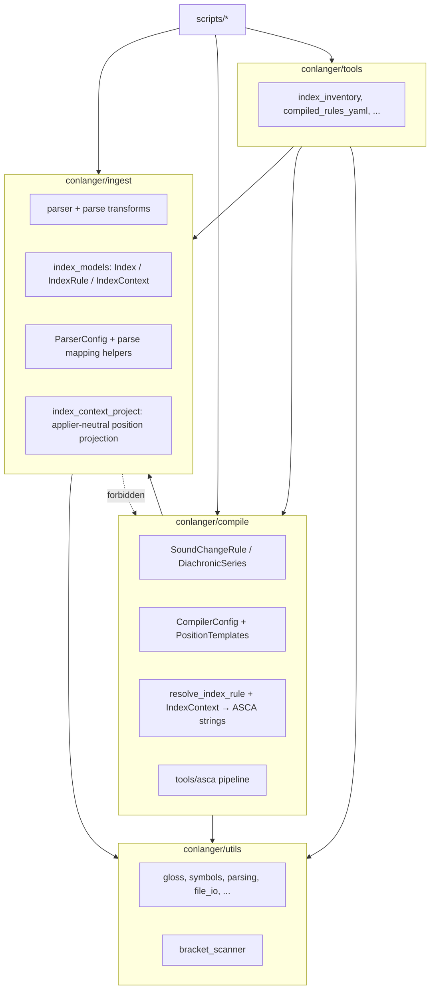

Type: grilling
Status: resolved
Blocked by: 148, 149

# Grill: parse vs compile package seams and shared utilities

Spawned from wayfinder session 2026-10-17. Owner input: **general utils** used by both stages are fine, but **compile-time logic** has landed in **parse** modules (e.g. `resolve_rule_env_exception_for_compile` in `ingest/models/index_models.py`, `compile.tools.asca` imports from `ingest/utils/transforms.py`).

## Question

Where should the **parse ↔ compile** boundary live in `src/conlanger/` (packages, modules, and public entrypoints) so that:

1. Parse loads HTML → applier-neutral YAML without importing ASCA compile transforms except shared pure helpers.
2. Compile + `validate_rules` own ASCA projection, env-set construction, and materialization (`materialize_index_rule_env_exception`, group mappings, etc.).
3. Shared code (`symbols`, gloss, IO) stays neutral and dependency direction is **ingest → (no compile)** and **compile → ingest models** only where unavoidable.

## Concrete relocations to decide

| Symbol | Today | Candidate home |
| --- | --- | --- |
| `resolve_rule_env_exception_for_compile` | `ingest/models/index_models.py` | `compile/resolve_index_rule.py` or dedicated resolver module |
| `resolve_index_context_to_string` / position templates | `ingest/models/index_models.py` | compile-side projection |
| `strip_editorial_in_before_syllable_position` import | parse `transforms.py` from `compile.tools.asca` | parse-only strip vs compile-only |
| `ingest/utils/mappings.py` ASCA feature targets | ingest | compile config application only? |

## Depends on

[148](148-grill-asca-shaped-syntax-in-applier-neutral-sot.md) and [149](149-grill-parse-time-asca-env-rewrites-vs-structured-indexcontext.md) — module moves follow what parse vs compile **owns**.

## Deliverable

Target module graph (one diagram or table), list of **allowed** cross-imports, and whether `index_models` stays parse-only Pydantic or splits into `ingest` + `compile` DTOs.

## Answer (2026-10-17)

Owner constraint: four clear top-level areas — **`ingest`** (parse), **`compile`** (compile), **`utils`** (shared), **`tools`** (mostly inventory / operator helpers). No fifth “shared compile” package under `compile/tools` for code that parse also needs.

### Module graph

### Allowed cross-imports

| From | May import |
| --- | --- |
| `ingest` | `utils` only (plus stdlib / pydantic) |
| `compile` | `ingest.models` (SoT types), `ingest` only where unavoidable for typed rule dicts — prefer `compile` owning projection so `ingest.models` stays thin; `utils` |
| `utils` | nothing under `ingest` / `compile` / `tools` |
| `tools` | `ingest`, `compile`, `utils` |
| `scripts` | same as `tools` |

**Hard rule:** `ingest` must not import `compile` (today: `transforms.py` → `syllable_position`, `flatten_nested_sets.py` → `bracket_scanner` — fix in [166](166-task-parse-compile-package-seam-refactor.md)).

### Concrete relocations

| Symbol | Today | Target home |
| --- | --- | --- |
| `resolve_rule_env_exception_for_compile`, `merge_medial_boundary_exception` | `ingest/models/index_models.py` | `compile/project_index_context.py` or `compile/resolve_index_rule.py` |
| `resolve_index_context_to_string` (ASCA compile projection + templates) | `index_models.py` | `compile/project_index_context.py` (uses `CompilerConfig.position_templates`) |
| Applier-neutral position projection (comma-join `context` + first `position` relation) | same function reused at parse | **`ingest/utils/index_context_project.py`** — duplicate template *logic* with default `PositionTemplates`-equivalent constants, **no** medial `exception` merge (compile-only per 149) |
| `strip_editorial_in_before_syllable_position` | `compile/tools/asca/syllable_position.py` | **`ingest/utils/syllable_position.py`** (parse editorial strip); compile syllable overrides import ingest helper or a thin re-export |
| `bracket_scanner` | `compile/tools/bracket_scanner.py` | **`utils/bracket_scanner.py`** |
| `CompilerConfig`, `PositionTemplates` | `ingest/models/mappings.py` | **`compile/models/config.py`** (name flexible) |
| `ParserConfig`, `FeatureMapping`, `normalize_feature_matrices_in_field`, IPA normalize at parse | `ingest/models/mappings.py` | **stay in ingest** (parse-time canonical feature names per 148) |
| `materialize_index_rule_env_exception` | `compile/resolve_index_rule.py` | **stay**; call moved compile resolvers only |

### `index_models`

**Single ingest module, Pydantic-only** for YAML SoT (`Index`, `IndexSection`, `IndexRule`, `IndexContext`) plus parse lifecycle (`working_text`, `update_rule`, …). **No** compile projection functions on that module after [166](166-task-parse-compile-package-seam-refactor.md). **No** separate compile DTO layer — compile materializes env/exception to strings on rule dicts before `SoundChangeRule` construction (unchanged).

### Follow-on

Implementation: [Task: refactor parse vs compile package seams](166-task-parse-compile-package-seam-refactor.md).
